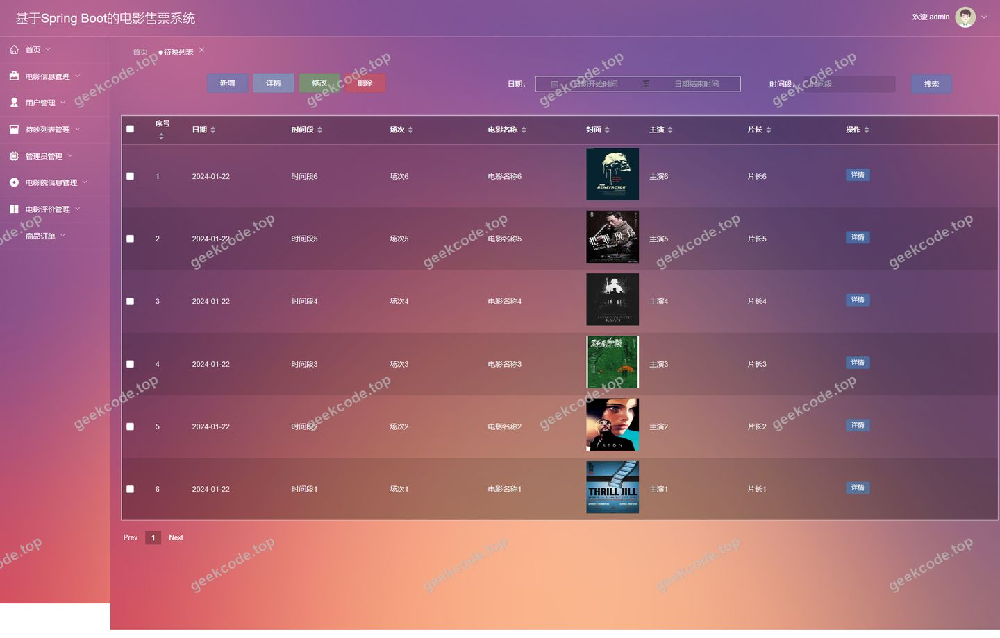
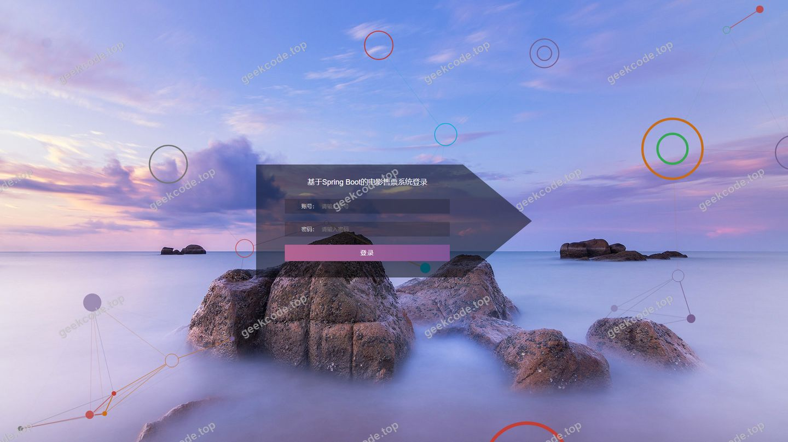
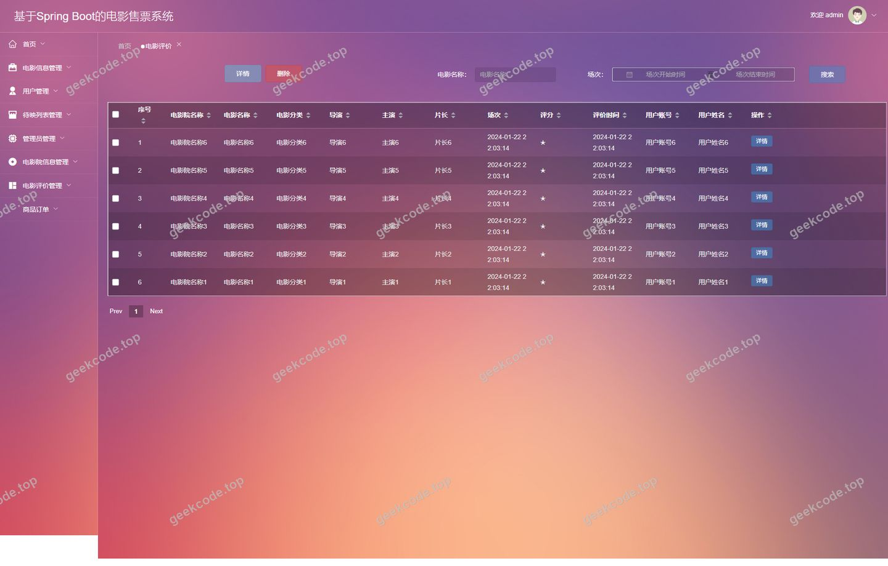
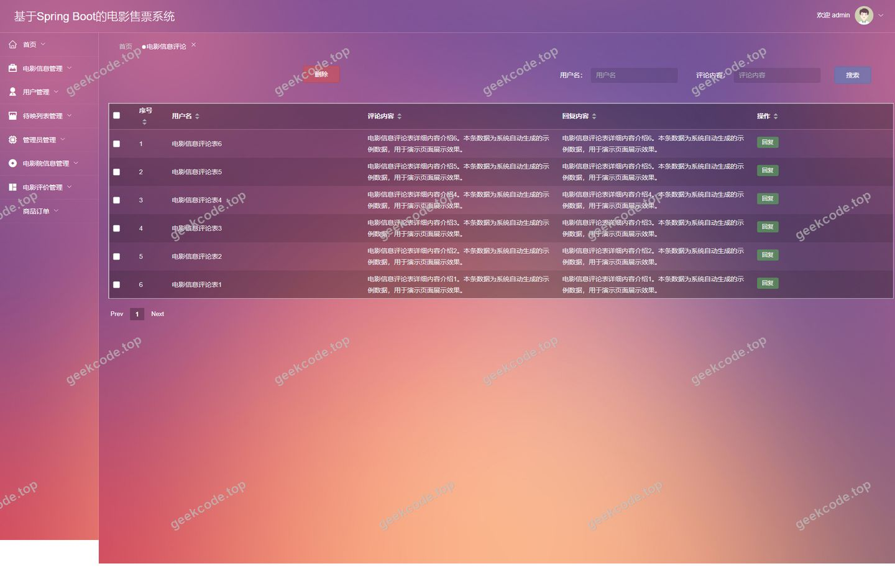
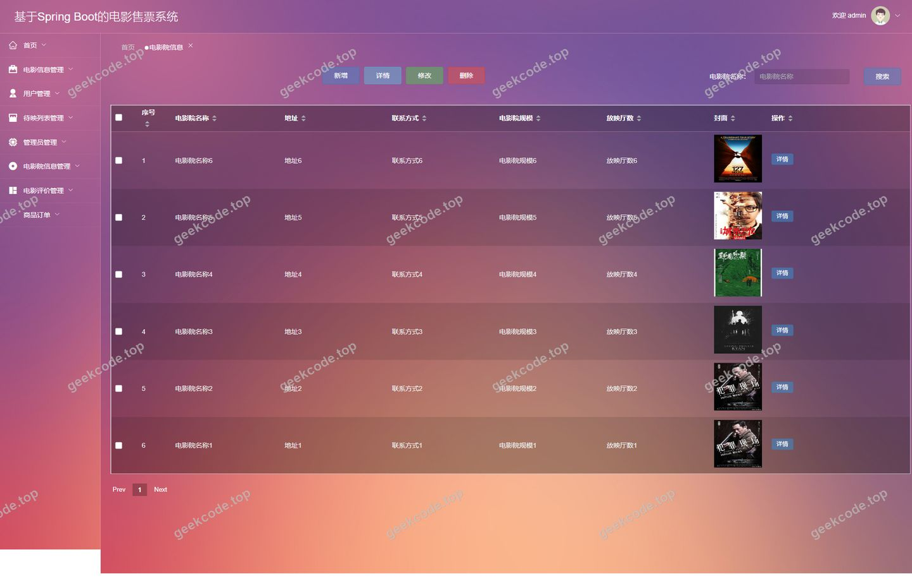
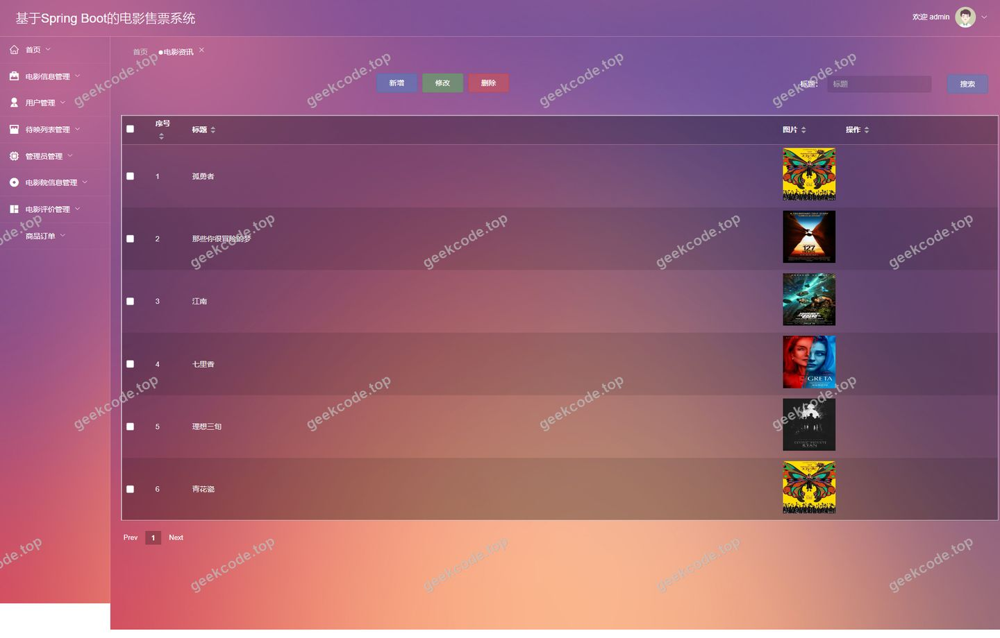
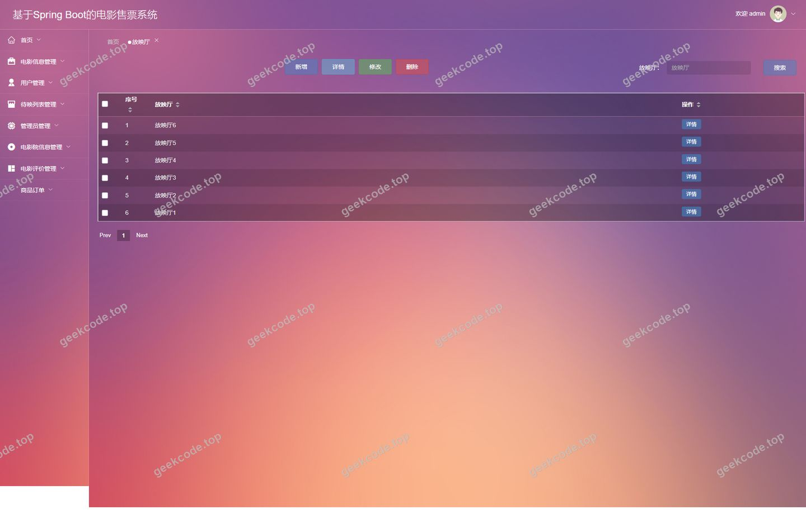
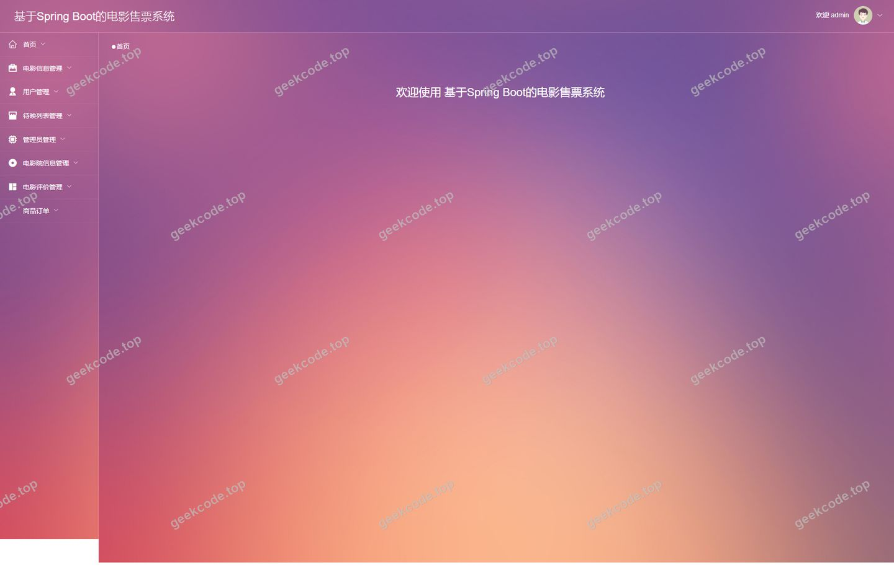

# 基于Spring Boot的电影售票系统

> 🎓 **计算机毕业设计 · 基于Spring Boot的电影售票系统**
>
> 本仓库只放**项目介绍 + 运行截图**（截图是站点带水印的原图，存在仓库 `images/` 里）。
>
> 👉 **完整可运行源码 / 数据库脚本 / 部署文档：[点我获取](https://geekcode.top/archives/%E5%9F%BA%E4%BA%8ESpring-Boot%E7%9A%84%E7%94%B5%E5%BD%B1%E5%94%AE%E7%A5%A8%E7%B3%BB%E7%BB%9F?utm_source=github)**
>
> 💬 咨询微信：**ir9372**　|　🌐 更多项目：[极客代码 geekcode.top](https://geekcode.top/?utm_source=github)
>
> 📌 项目详情页：<https://geekcode.top/archives/%E5%9F%BA%E4%BA%8ESpring-Boot%E7%9A%84%E7%94%B5%E5%BD%B1%E5%94%AE%E7%A5%A8%E7%B3%BB%E7%BB%9F?utm_source=github>

<table><td width="230" align="center"> <b>扫码加微信 ir9372</b></td><td valign="middle">📦 源码 = 项目介绍 + 全部运行截图 + 数据库 + 部署文档 👉 点上方任意截图，直接跳到 <b>极客代码 geekcode.top</b> 详情页</td></table>

---

<h1>基于Spring Boot的电影售票系统</h1>
<h2>项目概述</h2>

本项目为“基于Spring Boot的电影售票系统”，旨在构建一个前后端分离的在线电影票务与信息管理服务平台。系统核心功能涵盖电影资讯发布、影院及放映厅管理、待映影片展示、用户购票订单处理以及电影评价互动等模块。适用人群包括普通观影用户、影院管理员及系统超级管理员。技术架构上，后端采用 Spring Boot 框架结合 MyBatis-Plus 进行数据持久化操作，利用 Apache Shiro 实现权限控制；前端采用 Vue.js 构建单页应用，通过 RESTful API 与后端交互。该系统解决了传统线下售票效率低、信息更新不及时的问题，实现了电影资源的数字化管理与在线交易闭环。

<h2>技术架构</h2>
<h3>1. 总体架构</h3>

项目采用典型的 B/S（Browser/Server）架构，遵循前后端分离开发模式。

<ul>
<li><strong>前端层</strong>：基于 Vue.js 框架，负责页面渲染、路由管理及用户交互逻辑。通过 Axios 发送 HTTP 请求与后端通信。</li>
<li><strong>后端服务层</strong>：基于 Spring Boot 快速搭建微服务基础，提供 RESTful API 接口。集成 Apache Shiro 进行身份认证与会话管理，确保系统安全性。</li>
<li><strong>数据访问层</strong>：使用 MyBatis-Plus 作为 ORM 框架，简化 CRUD 操作，支持动态 SQL 生成。底层数据库连接依赖 MySQL Connector Java。</li>
</ul>
<h3>2. 核心技术选型理由</h3>
<ul>
<li><strong>Spring Boot</strong>: 提供自动配置和内嵌容器，大幅降低部署复杂度，适合快速迭代开发。</li>
<li><strong>MyBatis-Plus</strong>: 在 MyBatis 基础上增强，无需编写大量 XML 映射文件即可实现通用 CRUD，提升开发效率。</li>
<li><strong>Apache Shiro</strong>: 轻量级安全框架，相比 Spring Security 配置更简单，适用于中小型项目的权限管理需求，能够灵活控制后台路由及前台个人中心的访问权限。</li>
<li><strong>Vue.js</strong>: 响应式数据绑定机制使得界面状态同步更加直观，组件化开发利于维护复杂的后台管理系统界面。</li>
</ul>
<h3>3. 数据库设计要点</h3>

根据代码上下文中的实体类命名推断，数据库主要包含以下核心表结构：

<ul>
<li><code>yonghu</code> (用户表): 存储注册用户基本信息。</li>
<li><code>dianyingxinxi</code> (电影信息表): 存储已上映或正在热映的电影详情。</li>
<li><code>daiyingliebiao</code> (待映列表表): 存储即将上映的电影预告信息。</li>
<li><code>fangyingting</code> (放映厅表): 记录影院内的具体影厅信息及座位布局关联。</li>
<li><code>dianyingyuanxinxi</code> (电影院信息表): 存储线下实体影院的基础资料。</li>
<li><code>orders</code> (订单表): 记录用户的购票交易流水。</li>
<li><code>storeup</code> (收藏表): 存储用户对电影或影院的收藏记录。</li>
<li><code>discussdianyingxinxi</code> / <code>dianyingpingjia</code> (评论/评价表): 存储用户对电影的评论内容及评分。</li>
<li><code>news</code> (资讯表): 用于发布电影行业新闻或公告。</li>
<li><code>config</code> (配置表): 存储系统全局参数配置。</li>
</ul>
<h2>功能模块</h2>
<h3>1. 前台用户端功能</h3>

前台面向普通注册用户，提供浏览、搜索、购买及互动功能。

<table>
<thead>
<tr>
<th align="left">模块名称</th>
<th align="left">功能描述</th>
</tr>
</thead>
<tbody><tr>
<td align="left"><strong>首页与资讯</strong></td>
<td align="left">展示最新电影资讯 (<code>/index/newsList</code>)，提供系统入口导航。</td>
</tr>
<tr>
<td align="left"><strong>用户中心</strong></td>
<td align="left">包含个人信息查看 (<code>/index/yonghuDetail</code>)、修改 (<code>/index/yonghuAdd</code>) 及个人中心主页 (<code>/index/yonghuCenter</code>)。</td>
</tr>
<tr>
<td align="left"><strong>电影浏览</strong></td>
<td align="left">查看电影分类 (<code>/index/dianyingfenleiList</code>)、详细电影信息 (<code>/index/dianyingxinxiList</code>) 及待映影片列表 (<code>/index/daiyingliebiaoList</code>)。支持查看详情与添加新条目（视权限而定）。</td>
</tr>
<tr>
<td align="left"><strong>影院与排片</strong></td>
<td align="left">浏览电影院信息 (<code>/index/dianyingyuanxinxiList</code>) 和放映厅详情 (<code>/index/fangyingtingList</code>)，支持查询特定影院下的排片情况。</td>
</tr>
<tr>
<td align="left"><strong>互动社区</strong></td>
<td align="left">查看电影评价 (<code>/index/dianyingpingjiaList</code>) 和电影评论 (<code>/index/discussdianyingxinxiList</code>)，允许用户发表评论或新增评价。</td>
</tr>
<tr>
<td align="left"><strong>收藏功能</strong></td>
<td align="left">用户可收藏喜欢的电影或影院，并在 <code>/index/storeupList</code> 中统一管理收藏记录。</td>
</tr>
<tr>
<td align="left"><strong>菜单管理</strong></td>
<td align="left">提供自定义菜单项的列表、详情及添加功能 (<code>/index/menuList</code>, <code>/index/menuAdd</code>)，可能用于个性化推荐或快捷入口。</td>
</tr>
</tbody></table>
<h3>2. 后台管理端功能</h3>

后台面向管理员，提供全量数据的增删改查及系统配置管理。

<table>
<thead>
<tr>
<th align="left">模块名称</th>
<th align="left">对应路由</th>
<th align="left">功能描述</th>
</tr>
</thead>
<tbody><tr>
<td align="left"><strong>用户管理</strong></td>
<td align="left"><code>/yonghu</code></td>
<td align="left">管理注册用户账号，包括查询、重置密码、禁用账户等操作。</td>
</tr>
<tr>
<td align="left"><strong>电影信息管理</strong></td>
<td align="left"><code>/dianyingxinxi</code></td>
<td align="left">维护已上映电影的详细信息，如海报、简介、时长、主演等。</td>
</tr>
<tr>
<td align="left"><strong>待映列表管理</strong></td>
<td align="left"><code>/daiyingliebiao</code></td>
<td align="left">录入和管理即将上映的电影预告信息，控制上架时间。</td>
</tr>
<tr>
<td align="left"><strong>影院信息管理</strong></td>
<td align="left"><code>/dianyingyuanxinxi</code></td>
<td align="left">管理线下合作影院的基本资料、地址、联系方式等。</td>
</tr>
<tr>
<td align="left"><strong>放映厅管理</strong></td>
<td align="left"><code>/fangyingting</code></td>
<td align="left">配置各影院下的放映厅信息，关联座位数及设备类型。</td>
</tr>
<tr>
<td align="left"><strong>订单管理</strong></td>
<td align="left"><code>/orders</code></td>
<td align="left">查看所有用户购票订单，处理退款、核销票券等业务流程。</td>
</tr>
<tr>
<td align="left"><strong>评价与评论管理</strong></td>
<td align="left"><code>/dianyingpingjia</code>, <code>/discussdianyingxinxi</code></td>
<td align="left">审核用户提交的电影评价和评论内容，删除违规信息。</td>
</tr>
<tr>
<td align="left"><strong>资讯管理</strong></td>
<td align="left"><code>/news</code></td>
<td align="left">发布和管理电影相关的新闻资讯文章。</td>
</tr>
<tr>
<td align="left"><strong>分类管理</strong></td>
<td align="left"><code>/dianyingfenlei</code></td>
<td align="left">定义电影的类型标签（如动作、喜剧），便于前台筛选。</td>
</tr>
<tr>
<td align="left"><strong>收藏监控</strong></td>
<td align="left"><code>/storeup</code></td>
<td align="left">查看用户的收藏行为数据，辅助分析热门影片。</td>
</tr>
<tr>
<td align="left"><strong>系统配置</strong></td>
<td align="left"><code>/config</code></td>
<td align="left">设置系统全局参数，如轮播图链接、网站标题、联系电话等。</td>
</tr>
</tbody></table>
<h2>用户角色与权限</h2>

根据项目结构和 Shiro 权限框架的应用，系统主要划分为两类角色：<strong>普通用户</strong>和<strong>系统管理员</strong>。

<h3>1. 普通用户 (User)</h3>
<ul>
<li><strong>登录权限</strong>：需注册并通过验证后方可登录前台系统。</li>
<li><strong>访问范围</strong>：仅限前台路由 (<code>/index/*</code>)。</li>
<li><strong>具体功能权限</strong>：</li>
<li><strong>浏览</strong>：查看所有电影、影院、放映厅、资讯、评价及评论列表。</li>
<li><strong>个人中心</strong>：查看和修改个人资料，管理自己的收藏列表。</li>
<li><strong>互动</strong>：发表电影评论，提交电影评价。</li>
<li><strong>受限操作</strong>：虽然前台路由中存在 <code>...Add</code> 路径（如 <code>/index/dianyingxinxiAdd</code>），但在常规业务逻辑中，这些通常仅对拥有特殊编辑权限的用户开放，或在未登录状态下隐藏。默认情况下，普通用户主要执行读取和个人数据维护操作。</li>
</ul>
<h3>2. 系统管理员 (Admin)</h3>
<ul>
<li><strong>登录权限</strong>：拥有独立的后台登录入口，具备最高权限。</li>
<li><strong>访问范围</strong>：仅限后台路由 (<code>/admin/*</code> 或直接映射至根目录的管理视图)。</li>
<li><strong>具体功能权限</strong>：</li>
<li><strong>全量数据管理</strong>：对所有业务实体（电影、影院、订单、用户、资讯等）执行完整的 Create, Read, Update, Delete (CRUD) 操作。</li>
<li><strong>内容审核</strong>：对用户提交的评论和评价进行审核或删除。</li>
<li><strong>系统配置</strong>：修改全局系统参数。</li>
<li><strong>用户监管</strong>：管理普通用户账号状态。</li>
</ul>
<h2>项目特色与创新点</h2>
<ol>
<li><strong>前后端完全分离架构</strong>：采用 Vue + Spring Boot 组合，提升了系统的可扩展性和维护性。前端专注于用户体验与交互逻辑，后端专注于业务处理与数据安全，符合现代 Web 开发标准。</li>
<li><strong>细粒度的业务模块划分</strong>：系统将“已上映电影”与“待映列表”分开管理，同时独立维护“电影院”与“放映厅”信息。这种设计更贴近真实商业场景，支持复杂的排片逻辑和多影院联动。</li>
<li><strong>集成化的互动体系</strong>：不仅包含基础的票务流程，还深度集成了“电影评价”、“电影评论”和“收藏”功能。通过 <code>discussdianyingxinxi</code> 和 <code>dianyingpingjia</code> 双表设计，区分了即时讨论与结构化评分，丰富了用户参与维度。</li>
<li><strong>Shiro 安全防护</strong>：引入 Apache Shiro 进行权限控制，确保了后台管理接口的安全性，防止未授权访问敏感数据（如订单和用户隐私）。</li>
</ol>
<h2>部署环境</h2>

为确保项目正常运行，需要准备以下软件环境：

<ol>
<li><strong>Java 运行环境</strong>：</li>
</ol>
<ul>
<li>JDK 版本：建议 JDK 1.8 或 JDK 11（兼容 Spring Boot 主流版本）。</li>
</ul>
<ol start="2">
<li><strong>数据库服务器</strong>：</li>
</ol>
<ul>
<li>MySQL：版本 5.7 或 8.0。</li>
<li>需创建对应的数据库实例，并导入项目提供的 SQL 初始化脚本以建立表结构。</li>
</ul>
<ol start="3">
<li><strong>后端构建工具</strong>：</li>
</ol>
<ul>
<li>Maven：用于依赖管理和项目打包。</li>
</ul>
<ol start="4">
<li><strong>前端运行环境</strong>：</li>
</ol>
<ul>
<li>Node.js：建议 LTS 版本（如 v14.x 或 v16.x）。</li>
<li>npm 或 yarn：用于安装前端依赖包。</li>
</ul>
<ol start="5">
<li><strong>Web 服务器</strong>：</li>
</ol>
<ul>
<li>生产环境建议使用 Nginx 托管前端静态资源，并反向代理 API 请求至后端 Tomcat/Jetty 服务。</li>
<li>开发环境可直接使用 Spring Boot 内置服务器启动后端，配合 Vue CLI 或 Vite 启动前端开发服务器。</li>
</ul>
<h2>五、技术特性</h2>
<ul>
<li>前后端分离架构，前端独立部署</li>
<li>使用 MyBatis-Plus 简化数据访问层开发</li>
<li>集成 Shiro 权限框架实现角色权限控制</li>
</ul>
<h2>六、功能模块截图</h2>
<h3>后台管理端</h3>
<h4>后台-待映列表</h4>

<h4>后台-登录页</h4>

<h4>后台-电影评价</h4>

<h4>后台-电影信息评论</h4>

<h4>后台-电影院信息</h4>

<h4>后台-电影资讯</h4>

<h4>后台-放映厅</h4>

<h4>页面-首页</h4>

---

## 获取完整源码

| 项目 | 说明 |
| --- | --- |
| 项目名 | 基于Spring Boot的电影售票系统 |
| 运行截图 | 本文 8 张（站点带水印原图，仓库 `images/` 目录） |
| 完整源码 | [https://geekcode.top/archives/%E5%9F%BA%E4%BA%8ESpring-Boot%E7%9A%84%E7%94%B5%E5%BD%B1%E5%94%AE%E7%A5%A8%E7%B3%BB%E7%BB%9F?utm_source=github](https://geekcode.top/archives/%E5%9F%BA%E4%BA%8ESpring-Boot%E7%9A%84%E7%94%B5%E5%BD%B1%E5%94%AE%E7%A5%A8%E7%B3%BB%E7%BB%9F?utm_source=github) |
| 咨询微信 | **ir9372**（备注：jingpin-yuanma） |
| 更多项目 | [极客代码 geekcode.top](https://geekcode.top/?utm_source=github) |

> 需要源码、部署、改配置、跑不起来等问题，加微信 ir9372 沟通，说明项目名即可。
